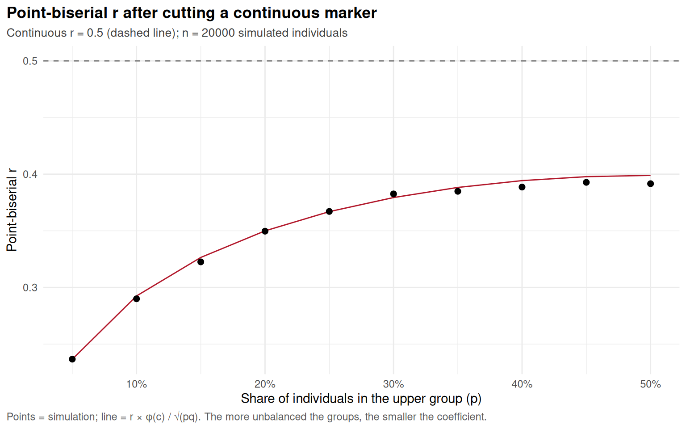
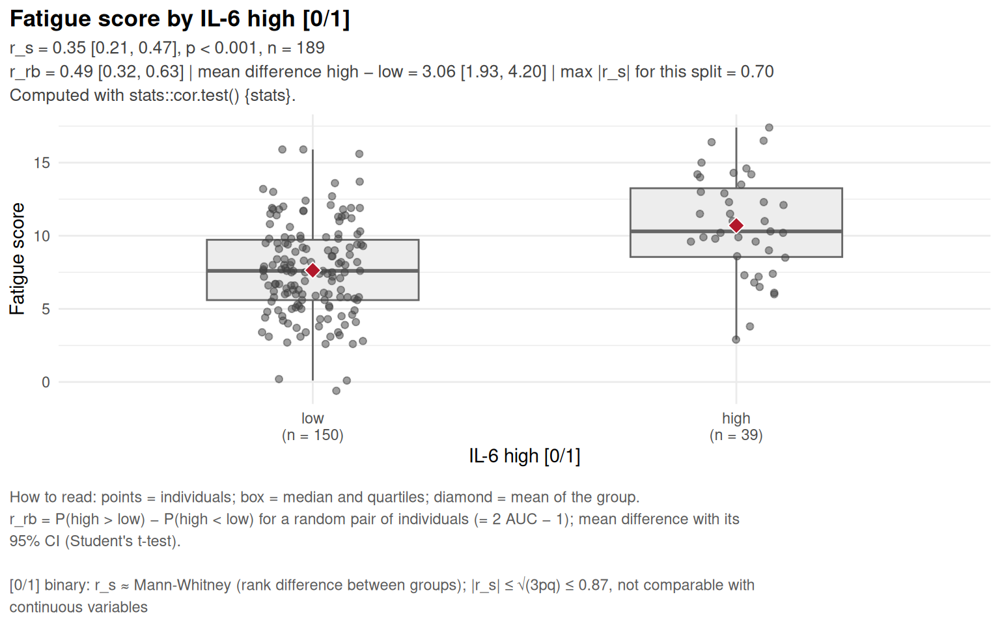
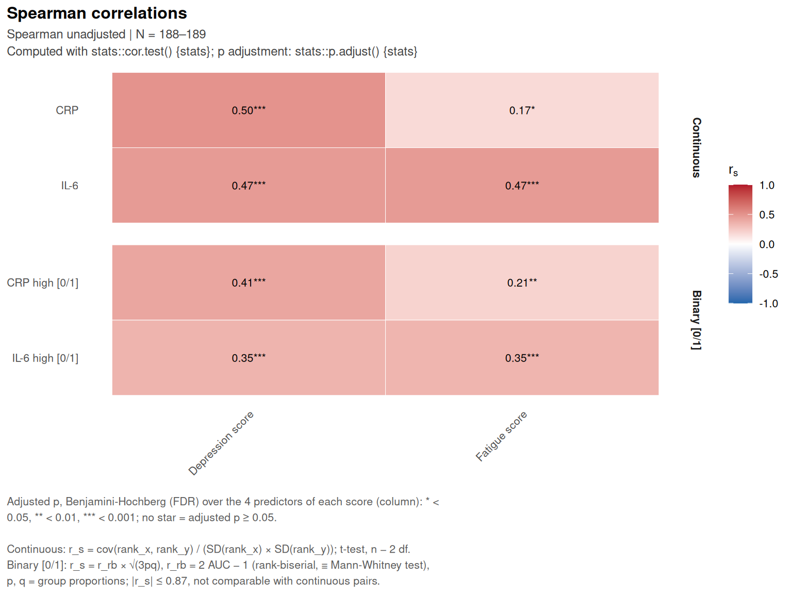

# Variables binaires dans une analyse de corrélation

``` r

library(corrkit)
library(ggplot2)
d   <- simulate_cor_data(n = 200)
lab <- attr(d, "labels")
```

Un biomarqueur « haut » vs « bas », le sexe, un traitement : une
variable à deux modalités peut entrer dans une corrélation. Le calcul
est valide, mais le coefficient obtenu **ne se lit pas comme celui d’une
variable continue**. Cette vignette explique pourquoi, ce que `corrkit`
fait de ces variables et ce qu’il faut rapporter à la place.

## Codage

[`as_cor_numeric()`](https://clement-poupelin.github.io/corrkit/reference/as_cor_numeric.md)
code une variable binaire en 0/1, la modalité **haute** (le second
niveau du facteur) valant 1. Un coefficient positif signifie donc « plus
élevé dans le groupe haut ». Ce recodage est une transformation linéaire
croissante : il ne change ni le coefficient, ni sa p-value.

``` r

table(d$BIN_CRP, as_cor_numeric(d$BIN_CRP), useNA = "ifany")
#>       
#>         0  1 <NA>
#>   low  96  0    0
#>   high  0 98    0
#>   <NA>  0  0    6
```

Dans les graphiques et les tableaux, les variables binaires portent la
marque `[0/1]` (argument `bin_mark`) et sont rangées dans un bloc à
part.

## Pearson : la corrélation point-bisériale est un test t

Avec une variable 0/1, le r de Pearson est la corrélation
**point-bisériale** :

``` math
r_{pb} = \frac{M_1 - M_0}{SD_y}\sqrt{pq},
```

où $`M_1, M_0`$ sont les moyennes de y dans les deux groupes, $`p, q`$
les proportions des groupes et $`SD_y`$ l’écart-type de y (dénominateur
n). Son test est exactement le test t de Student à variances égales :

``` r

g <- as_cor_numeric(d$BIN_CRP); y <- d$depression; ok <- complete.cases(g, y)
c(cor_test = partial_cor_test(g, y, meth = "pearson")$p.value,
  t_test   = t.test(y[ok & g == 1], y[ok & g == 0], var.equal = TRUE)$p.value)
#>     cor_test       t_test 
#> 9.689758e-09 9.689758e-09
```

Ajustée sur des covariables, c’est le test de la pente de
`lm(y ~ groupe + covariables)` (même t, mêmes degrés de liberté).

## Pourquoi le coefficient est plus petit

### Un biomarqueur coupé perd de la corrélation

Quand un biomarqueur continu est coupé en deux groupes, la corrélation
avec un score diminue mécaniquement. Pour une loi normale coupée au
seuil c (en écarts-types), avec une proportion p au-dessus du seuil :

``` math
r_{pb} = r \times \frac{\varphi(c)}{\sqrt{pq}},
```

$`\varphi`$ étant la densité de la loi normale. Le facteur vaut au plus
0,80 (coupure à la médiane) et 0,70 pour une répartition 20/80. On le
vérifie par simulation :

``` r

set.seed(1)
n <- 20000; r <- 0.5
x <- rnorm(n); yy <- r * x + sqrt(1 - r^2) * rnorm(n)
sim <- do.call(rbind, lapply(seq(0.05, 0.5, by = 0.05), function(p) {
  c_ <- qnorm(1 - p)                         # seuil : une proportion p au-dessus
  b  <- as.numeric(x > c_)
  data.frame(p = p, observed = cor(b, yy), theory = r * dnorm(c_) / sqrt(p * (1 - p)))
}))
round(sim, 3)
#>       p observed theory
#> 1  0.05    0.237  0.237
#> 2  0.10    0.290  0.292
#> 3  0.15    0.323  0.326
#> 4  0.20    0.350  0.350
#> 5  0.25    0.367  0.367
#> 6  0.30    0.383  0.379
#> 7  0.35    0.385  0.388
#> 8  0.40    0.389  0.394
#> 9  0.45    0.393  0.398
#> 10 0.50    0.392  0.399
```

``` r

ggplot(sim, aes(p, observed)) +
  geom_hline(yintercept = r, linetype = "dashed", colour = "grey50") +
  geom_line(aes(y = theory), colour = COR_PAL[["high"]]) +
  geom_point(size = 2) +
  scale_x_continuous(labels = function(v) paste0(100 * v, "%")) +
  labs(title = "Point-biserial r after cutting a continuous marker",
       subtitle = sprintf("Continuous r = %.1f (dashed line); n = %d simulated individuals", r, n),
       x = "Share of individuals in the upper group (p)", y = "Point-biserial r",
       caption = "Points = simulation; line = r × φ(c) / √(pq). The more unbalanced the groups, the smaller the coefficient.") +
  theme_pub(11)
```



À effet identique, le r d’un biomarqueur binaire est donc plus petit que
celui du même biomarqueur continu, et d’autant plus que les groupes sont
déséquilibrés (Babchishin & Helmus 2016) : **les deux ne sont pas
comparables**.

### Spearman : un test de Mann-Whitney déguisé

Avec deux groupes, le r_s de Spearman est une corrélation de Pearson sur
les rangs de y ; c’est une fonction linéaire du U de Mann-Whitney. Sans
ex æquo dans y :

``` math
r_s = r_{rb}\sqrt{3pq}, \qquad r_{rb} = \frac{2U}{n_0 n_1} - 1 = 2\,\mathrm{AUC} - 1,
```

où $`r_{rb}`$ est la corrélation **rang-bisériale** (Kerby 2014) : la
probabilité qu’un individu du groupe haut ait un score plus élevé qu’un
individu du groupe bas, moins la probabilité inverse. Même quand les
deux groupes sont parfaitement séparés ($`r_{rb} = 1`$), $`|r_s|`$ ne
dépasse pas $`\sqrt{3pq}`$ : 0,87 à 50/50, 0,69 à 20/80.

``` r

eff <- cor_binary_effects(d, c("BIN_CRP", "BIN_IL6"), c("depression", "fatigue"), labels = lab)
eff[, c("X", "Y", "prop1", "r_rb", "r_s", "r_s_bound")]
#> # A tibble: 4 × 6
#>   X       Y          prop1  r_rb   r_s r_s_bound
#>   <chr>   <chr>      <dbl> <dbl> <dbl>     <dbl>
#> 1 BIN_CRP depression 0.505 0.479 0.414     0.866
#> 2 BIN_CRP fatigue    0.516 0.237 0.205     0.866
#> 3 BIN_IL6 depression 0.197 0.510 0.352     0.689
#> 4 BIN_IL6 fatigue    0.206 0.493 0.346     0.701
with(eff, cbind(r_s, r_rb_x_sqrt3pq = r_rb * sqrt(3 * prop1 * (1 - prop1))))
#>            r_s r_rb_x_sqrt3pq
#> [1,] 0.4144474      0.4144141
#> [2,] 0.2051657      0.2051436
#> [3,] 0.3515586      0.3515305
#> [4,] 0.3458298      0.3457938
```

L’égalité n’est approximative que parce que les scores simulés
contiennent des ex æquo.

### Kendall

Le numérateur du τ de Kendall (paires concordantes − paires
discordantes) ne compte que les paires prises dans deux groupes
différents, et vaut $`n_0 n_1 \times r_{rb}`$ : c’est encore la
comparaison de Mann-Whitney, avec un maximum qui dépend de la
répartition et des ex æquo.

## Ce qu’il faut rapporter

La corrélation reste utile pour **tester** l’association (son test est
celui de Student ou de Mann-Whitney). Pour **la taille de l’effet**, on
rapporte la différence entre groupes et la corrélation rang-bisériale :

``` r

tbl_cor_binary(eff)
```

[TABLE]

La dernière colonne place le r_s observé à côté de son maximum pour
cette répartition : un r_s de 0,30 avec un maximum de 0,69 n’a pas le
même sens qu’un r_s de 0,30 entre deux variables continues.

[`plot_cor_pair()`](https://clement-poupelin.github.io/corrkit/reference/plot_cor_pair.md)
montre la même chose sur un graphique : les valeurs par groupe, avec
r_s, r_rb et la différence de moyennes dans le sous-titre.

``` r

plot_cor_pair(d, "BIN_IL6", "fatigue", labels = lab)
```



## Dans les heatmaps et les tableaux

Les cases qui font intervenir une variable binaire sont regroupées dans
un bloc à part, et la légende donne la formule du coefficient réellement
calculé :

``` r

res <- plot_cor_cross(d, c("CRP", "IL6", "BIN_CRP", "BIN_IL6"), c("depression", "fatigue"), labels = lab)
res$plot
```



`res$note` contient la note complète, et
[`cor_binary_note()`](https://clement-poupelin.github.io/corrkit/reference/cor_binary_note.md)
la fournit en anglais (légendes, notes de tableau) ou en français
(encadrés d’un rapport), en version courte ou complète :

``` r

cor_binary_note("spearman", lang = "fr", short = TRUE)
#> [1] "[0/1] binaire : r_s ≈ Mann-Whitney (écart de rangs entre groupes) ; |r_s| ≤ √(3pq) ≤ 0,87, non comparable aux variables continues"
cat(strwrap(cor_binary_note("spearman", lang = "fr"), 90), sep = "\n")
#> Variables binaires (notées [0/1], classe haute = 1) : le r_s de Spearman est une
#> corrélation de Pearson sur les rangs ; avec deux groupes, c'est une fonction linéaire du
#> U de Mann-Whitney (même test, à l'approximation près) : il mesure si les scores tendent à
#> être mieux classés dans le groupe haut. r_s = r_rb × √(3pq), où r_rb = 2 AUC − 1 est la
#> corrélation rang-bisériale (p/q = répartition entre groupes, sans ex aequo) : |r_s| ≤
#> 0,87 à 50/50 et 0,69 à 20/80. Il n'est donc pas comparable au r_s d'un biomarqueur
#> continu : la taille de l'effet est r_rb ou la différence entre groupes. La version
#> partielle (ajustée) se lit de la même façon. (Kerby 2014, Comprehensive Psychology,
#> doi:10.2466/11.IT.3.1; Babchishin & Helmus 2016, Behav Res Methods,
#> doi:10.3758/s13428-015-0627-7).
```

## Références

- Kerby DS (2014). The simple difference formula: an approach to
  teaching nonparametric correlation. *Comprehensive Psychology*
  3:11.IT.3.1. doi:10.2466/11.IT.3.1
- Babchishin KM, Helmus LM (2016). The influence of base rates on
  correlations: an evaluation of proposed alternative effect sizes with
  real-world data. *Behavior Research Methods* 48:1021-1031.
  doi:10.3758/s13428-015-0627-7
- Makowski D, Ben-Shachar MS, Patil I, Lüdecke D (2020). Methods and
  algorithms for correlation analysis in R. *Journal of Open Source
  Software* 5(51):2306. doi:10.21105/joss.02306
