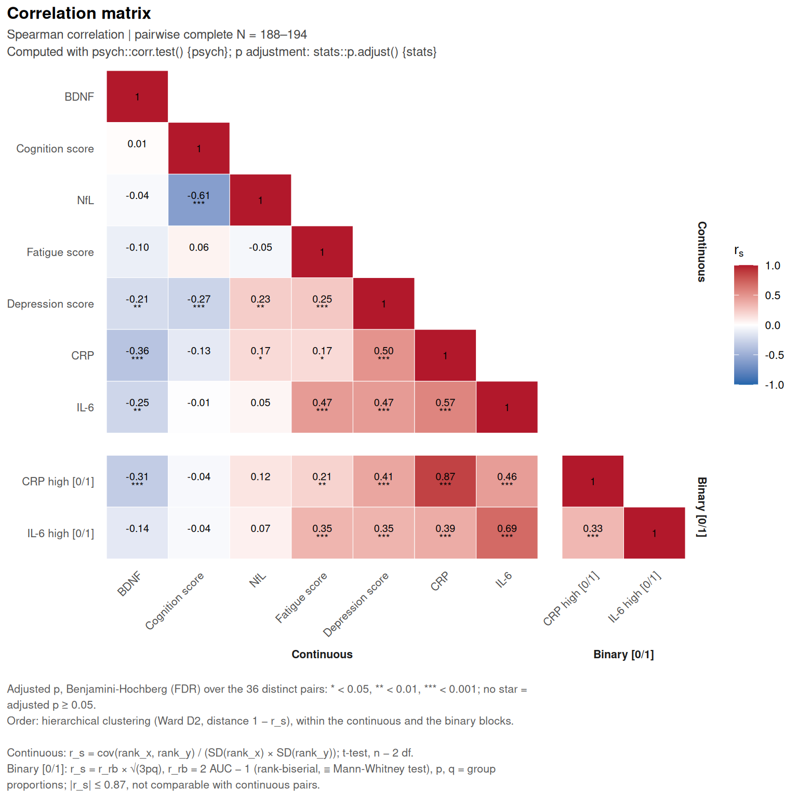
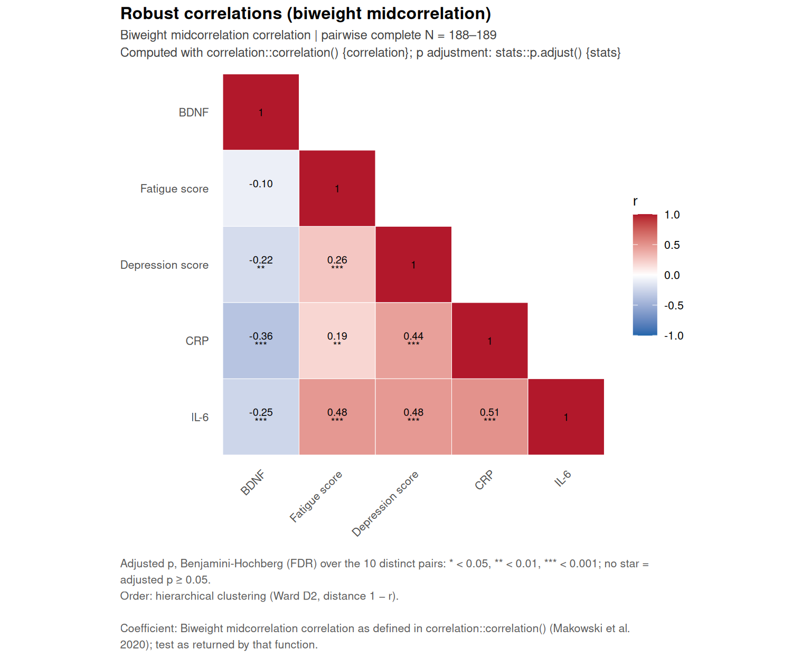

# Prise en main de corrkit

``` r

library(corrkit)
```

## L’idée : ne rien recalculer, tout expliquer

`corrkit` ne contient **aucun nouvel estimateur**. Chaque coefficient,
chaque p-value et chaque intervalle vient d’une fonction existante et
validée ; le package ajoute par-dessus une manière de travailler et des
sorties qui disent ce qu’elles montrent.

| Ce qui est calculé | Fonction utilisée | Repli si le package manque |
|----|----|----|
| Une paire, sans ajustement | [`stats::cor.test()`](https://rdrr.io/r/stats/cor.test.html) | — |
| Une paire, partielle | [`ppcor::pcor.test()`](https://rdrr.io/pkg/ppcor/man/pcor.test.html) (Kim 2015) | corrélation des résidus de [`stats::lm.fit()`](https://rdrr.io/r/stats/lmfit.html) |
| Toutes les paires (matrice) | `psych::corr.test(adjust = "none")` ou `correlation::correlation(p_adjust = "none")` (Makowski et al. 2020) | [`stats::cor.test()`](https://rdrr.io/r/stats/cor.test.html) paire par paire |
| Intervalle de confiance | [`correlation::cor_to_ci()`](https://easystats.github.io/correlation/reference/cor_to_p.html) | transformation z de Fisher en R de base |
| Ajustement pour tests multiples | [`stats::p.adjust()`](https://rdrr.io/r/stats/p.adjust.html) | — |
| Effets des variables binaires | [`stats::t.test()`](https://rdrr.io/r/stats/t.test.html), [`stats::wilcox.test()`](https://rdrr.io/r/stats/wilcox.test.html), [`effectsize::rank_biserial()`](https://easystats.github.io/effectsize/reference/rank_biserial.html) | IC de r_rb non calculé |

Ce que `corrkit` ajoute :

1.  **une famille de tests explicite** pour l’ajustement des p-values
    (argument `adjust_by`, Benjamini-Hochberg par défaut) ;
2.  **un traitement à part des variables binaires** (biomarqueur « haut
    » vs « bas », sexe…) : blocs séparés, marque `[0/1]`, note de
    lecture, et les tailles d’effet à rapporter à la place de la
    corrélation ;
3.  **des sorties annotées** : chaque graphique et chaque tableau
    indique la méthode, le moteur de calcul, les formules (notation de
    Makowski et al. 2020), l’ajustement et la façon de lire le résultat.

Les fonctions publiques suivent toutes le même schéma : `cor_*()`
calcule, `plot_*()` dessine (un `ggplot`), `tbl_*()` met en forme (un
tableau `gt`).

## Données d’exemple

[`simulate_cor_data()`](https://clement-poupelin.github.io/corrkit/reference/simulate_cor_data.md)
génère des données dont on connaît la structure : une inflammation
latente qui pilote CRP, IL-6, BDNF et le score de dépression ; IL-6 qui
pilote la fatigue ; l’âge qui pilote à la fois NfL et la cognition ; et
deux versions binaires des marqueurs (CRP coupée à la médiane, IL-6
coupée au 80^(e) percentile).

``` r

d <- simulate_cor_data(n = 200)
lab <- attr(d, "labels")
str(d)
#> 'data.frame':    200 obs. of  11 variables:
#>  $ age       : num  61 42 57 54 47 25 46 43 56 49 ...
#>  $ sex       : Factor w/ 2 levels "F","M": 1 1 1 2 2 2 1 1 2 2 ...
#>  $ CRP       : num  1.95 0.98 0.51 3.89 0.55 0.43 0.6 1.66 1.46 2.39 ...
#>  $ IL6       : num  0.82 -0.65 -0.28 0.71 -0.07 -0.45 -0.29 1.5 -1.36 0.14 ...
#>  $ BDNF      : num  0.3 -0.35 -0.21 0.89 1.55 1.31 0.32 0.17 -1.48 -1.3 ...
#>  $ NfL       : num  0.93 -0.15 -0.76 -0.86 -1.08 -1.47 -1.5 NA -0.99 -0.06 ...
#>  $ depression: num  7.3 7.3 NA 14.4 9.1 10.2 6 14.1 15.2 11.4 ...
#>  $ fatigue   : num  4 5.6 4.6 9.2 9.1 7.6 7.5 12.3 4.5 0.1 ...
#>  $ cognition : num  23.6 25.7 25.5 24.3 26 NA 27.6 26.3 26.1 27.7 ...
#>  $ BIN_CRP   : Factor w/ 2 levels "low","high": 2 1 1 2 1 1 1 2 2 2 ...
#>  $ BIN_IL6   : Factor w/ 2 levels "low","high": 1 1 1 1 1 1 1 2 1 1 ...
#>  - attr(*, "labels")= Named chr [1:11] "Age" "Sex" "CRP" "IL-6" ...
#>   ..- attr(*, "names")= chr [1:11] "age" "sex" "CRP" "IL6" ...
```

`lab` est un vecteur nommé variable → libellé ; toutes les fonctions
l’acceptent via l’argument `labels`.

## Une matrice de corrélations

``` r

vars <- c("CRP", "IL6", "BDNF", "NfL", "depression", "fatigue", "cognition", "BIN_CRP", "BIN_IL6")
cm <- cor_test_matrix(d, vars, method = "spearman", p_adjust = "BH")
cm
#> <cor_matrix> Spearman correlations, 9 variables (2 binary), 36 pairs
#>   engine: psych::corr.test() {psych} | p adjustment: Benjamini-Hochberg (FDR) over the 36 pairs | N = 188–194
#>            CRP      IL6     BDNF     NfL      depression fatigue cognition
#> CRP        1                                                              
#> IL6        0.57***  1                                                     
#> BDNF       -0.36*** -0.25** 1                                             
#> NfL        0.17*    0.05    -0.04    1                                    
#> depression 0.50***  0.47*** -0.21**  0.23**   1                           
#> fatigue    0.17*    0.47*** -0.10    -0.05    0.25***    1                
#> cognition  -0.13    -0.01   0.01     -0.61*** -0.27***   0.06    1        
#> BIN_CRP    0.87***  0.46*** -0.31*** 0.12     0.41***    0.21**  -0.04    
#> BIN_IL6    0.39***  0.69*** -0.14    0.07     0.35***    0.35*** -0.04    
#>            BIN_CRP BIN_IL6
#> CRP                       
#> IL6                       
#> BDNF                      
#> NfL                       
#> depression                
#> fatigue                   
#> cognition                 
#> BIN_CRP    1              
#> BIN_IL6    0.33*** 1
```

L’objet contient les matrices `r`, `p` (brutes), `p_adj`, `n`, les
bornes d’intervalle, le type de chaque variable et un tableau long
(`cm$long`, une ligne par paire).

### La heatmap

``` r

plot_cor_heatmap(cm, labels = lab)
```



Comment la lire :

- **le sous-titre** donne la méthode, l’effectif (complet par paire : il
  varie avec les valeurs manquantes) et la fonction qui a fait le calcul
  ;
- **chaque case** affiche le coefficient et les étoiles de la p-value
  **ajustée** ; la couleur suit une échelle unique de −1 (bleu) à +1
  (rouge) ;
- **les variables binaires** sont regroupées dans un bloc à part (en bas
  et à droite), car leur coefficient n’est pas sur la même échelle (voir
  [`vignette("binary-variables")`](https://clement-poupelin.github.io/corrkit/articles/binary-variables.md))
  ;
- **la légende du bas** rappelle la famille de l’ajustement, l’ordre des
  variables, la formule du coefficient et la lecture des cases binaires.

L’ordre par défaut regroupe les variables qui se ressemblent
(classification hiérarchique de Ward sur la distance 1 − r, à
l’intérieur de chaque bloc). `order = "original"` garde l’ordre donné ;
`separator = "line"` remplace les facettes par de simples traits.

### Les tableaux

Le même résultat en tableau, avec la même échelle de couleurs :

``` r

tbl_cor_matrix(cm, labels = lab)
```

| Correlation matrix |  |  |  |  |  |  |  |  |  |
|----|----|----|----|----|----|----|----|----|----|
| Spearman correlation \| pairwise complete N = 188–194 \| Computed with psych::corr.test() {psych} |  |  |  |  |  |  |  |  |  |
|  | CRP | IL-6 | BDNF | NfL | Depression score | Fatigue score | Cognition score | CRP high \[0/1\] | IL-6 high \[0/1\] |
| CRP | 1 |  |  |  |  |  |  |  |  |
| IL-6 | 0.57\*\*\* | 1 |  |  |  |  |  |  |  |
| BDNF | -0.36\*\*\* | -0.25\*\* | 1 |  |  |  |  |  |  |
| NfL | 0.17\* | 0.05 | -0.04 | 1 |  |  |  |  |  |
| Depression score | 0.50\*\*\* | 0.47\*\*\* | -0.21\*\* | 0.23\*\* | 1 |  |  |  |  |
| Fatigue score | 0.17\* | 0.47\*\*\* | -0.10 | -0.05 | 0.25\*\*\* | 1 |  |  |  |
| Cognition score | -0.13 | -0.01 | 0.01 | -0.61\*\*\* | -0.27\*\*\* | 0.06 | 1 |  |  |
| CRP high \[0/1\]¹ | 0.87\*\*\* | 0.46\*\*\* | -0.31\*\*\* | 0.12 | 0.41\*\*\* | 0.21\*\* | -0.04 | 1 |  |
| IL-6 high \[0/1\]¹ | 0.39\*\*\* | 0.69\*\*\* | -0.14 | 0.07 | 0.35\*\*\* | 0.35\*\*\* | -0.04 | 0.33\*\*\* | 1 |
| ¹ Binary variable \[0/1\], coded 0/1 (upper level = 1). |  |  |  |  |  |  |  |  |  |
| Adjusted p, Benjamini-Hochberg (FDR) over the 36 distinct pairs: \* \< 0.05, \*\* \< 0.01, \*\*\* \< 0.001; no star = adjusted p ≥ 0.05. |  |  |  |  |  |  |  |  |  |
| Continuous: r_s = cov(rank_x, rank_y) / (SD(rank_x) × SD(rank_y)); t-test, n − 2 df. |  |  |  |  |  |  |  |  |  |
| Binary \[0/1\]: r_s = r_rb × √(3pq), r_rb = 2 AUC − 1 (rank-biserial, ≡ Mann-Whitney test), p, q = group proportions; \|r_s\| ≤ 0.87, not comparable with continuous pairs. |  |  |  |  |  |  |  |  |  |
| Notation: Makowski D, Ben-Shachar MS, Patil I, Lüdecke D (2020), J Open Source Softw 5(51):2306, doi:10.21105/joss.02306. |  |  |  |  |  |  |  |  |  |

Et en format long, une ligne par paire, avec l’intervalle de confiance,
la p-value brute et la p-value ajustée (lignes significatives en gras) :

``` r

tbl_cor_long(cm, labels = lab, sort_by = "abs")
```

| Spearman correlations |  |  |  |  |  |  |  |
|----|----|----|----|----|----|----|----|
| Spearman correlation, all pairs \| pairwise complete N = 188–194 \| Computed with psych::corr.test() {psych} |  |  |  |  |  |  |  |
| Variable 1 | Variable 2 | Pair | n | rₛ | 95% CI | p (raw) | p (adjusted) |
| CRP | CRP high \[0/1\] | cont × bin | 194 | 0.87 | \[0.82, 0.90\] | \< 0.001 | \< 0.001 \*\*\* |
| IL-6 | IL-6 high \[0/1\] | cont × bin | 194 | 0.69 | \[0.61, 0.76\] | \< 0.001 | \< 0.001 \*\*\* |
| NfL | Cognition score | cont × cont | 188 | -0.61 | \[-0.69, -0.51\] | \< 0.001 | \< 0.001 \*\*\* |
| CRP | IL-6 | cont × cont | 188 | 0.57 | \[0.46, 0.66\] | \< 0.001 | \< 0.001 \*\*\* |
| CRP | Depression score | cont × cont | 188 | 0.50 | \[0.38, 0.61\] | \< 0.001 | \< 0.001 \*\*\* |
| IL-6 | Depression score | cont × cont | 188 | 0.47 | \[0.34, 0.57\] | \< 0.001 | \< 0.001 \*\*\* |
| IL-6 | Fatigue score | cont × cont | 189 | 0.47 | \[0.34, 0.57\] | \< 0.001 | \< 0.001 \*\*\* |
| IL-6 | CRP high \[0/1\] | cont × bin | 188 | 0.46 | \[0.33, 0.57\] | \< 0.001 | \< 0.001 \*\*\* |
| Depression score | CRP high \[0/1\] | cont × bin | 188 | 0.41 | \[0.28, 0.53\] | \< 0.001 | \< 0.001 \*\*\* |
| CRP | IL-6 high \[0/1\] | cont × bin | 188 | 0.39 | \[0.26, 0.51\] | \< 0.001 | \< 0.001 \*\*\* |
| CRP | BDNF | cont × cont | 188 | -0.36 | \[-0.48, -0.23\] | \< 0.001 | \< 0.001 \*\*\* |
| Depression score | IL-6 high \[0/1\] | cont × bin | 188 | 0.35 | \[0.22, 0.47\] | \< 0.001 | \< 0.001 \*\*\* |
| Fatigue score | IL-6 high \[0/1\] | cont × bin | 189 | 0.35 | \[0.21, 0.47\] | \< 0.001 | \< 0.001 \*\*\* |
| CRP high \[0/1\] | IL-6 high \[0/1\] | bin × bin | 188 | 0.33 | \[0.20, 0.46\] | \< 0.001 | \< 0.001 \*\*\* |
| BDNF | CRP high \[0/1\] | cont × bin | 188 | -0.31 | \[-0.44, -0.17\] | \< 0.001 | \< 0.001 \*\*\* |
| Depression score | Cognition score | cont × cont | 188 | -0.27 | \[-0.40, -0.12\] | \< 0.001 | \< 0.001 \*\*\* |
| Depression score | Fatigue score | cont × cont | 188 | 0.25 | \[0.11, 0.39\] | \< 0.001 | \< 0.001 \*\*\* |
| IL-6 | BDNF | cont × cont | 188 | -0.25 | \[-0.38, -0.10\] | \< 0.001 | 0.001 \*\* |
| NfL | Depression score | cont × cont | 188 | 0.23 | \[0.09, 0.37\] | 0.001 | 0.002 \*\* |
| BDNF | Depression score | cont × cont | 188 | -0.21 | \[-0.35, -0.07\] | 0.003 | 0.006 \*\* |
| Fatigue score | CRP high \[0/1\] | cont × bin | 188 | 0.21 | \[0.06, 0.34\] | 0.005 | 0.008 \*\* |
| CRP | NfL | cont × cont | 188 | 0.17 | \[0.03, 0.31\] | 0.018 | 0.030 \* |
| CRP | Fatigue score | cont × cont | 188 | 0.17 | \[0.02, 0.31\] | 0.019 | 0.030 \* |
| BDNF | IL-6 high \[0/1\] | cont × bin | 188 | -0.14 | \[-0.28, 0.01\] | 0.058 | 0.086 |
| CRP | Cognition score | cont × cont | 188 | -0.13 | \[-0.27, 0.01\] | 0.069 | 0.100 |
| NfL | CRP high \[0/1\] | cont × bin | 188 | 0.12 | \[-0.03, 0.26\] | 0.094 | 0.131 |
| BDNF | Fatigue score | cont × cont | 189 | -0.10 | \[-0.24, 0.05\] | 0.175 | 0.234 |
| NfL | IL-6 high \[0/1\] | cont × bin | 188 | 0.07 | \[-0.08, 0.21\] | 0.347 | 0.446 |
| Fatigue score | Cognition score | cont × cont | 188 | 0.06 | \[-0.09, 0.20\] | 0.435 | 0.540 |
| NfL | Fatigue score | cont × cont | 189 | -0.05 | \[-0.20, 0.10\] | 0.493 | 0.592 |
| IL-6 | NfL | cont × cont | 188 | 0.05 | \[-0.10, 0.19\] | 0.510 | 0.592 |
| Cognition score | CRP high \[0/1\] | cont × bin | 188 | -0.04 | \[-0.19, 0.11\] | 0.584 | 0.657 |
| Cognition score | IL-6 high \[0/1\] | cont × bin | 188 | -0.04 | \[-0.18, 0.11\] | 0.606 | 0.661 |
| BDNF | NfL | cont × cont | 189 | -0.04 | \[-0.18, 0.11\] | 0.627 | 0.664 |
| BDNF | Cognition score | cont × cont | 188 | 0.01 | \[-0.13, 0.16\] | 0.839 | 0.863 |
| IL-6 | Cognition score | cont × cont | 188 | -0.01 | \[-0.16, 0.14\] | 0.891 | 0.891 |
| Pair: cont = continuous, bin = binary\[0/1\]. Bold = adjusted p \< 0.05. |  |  |  |  |  |  |  |
| Adjusted p, Benjamini-Hochberg (FDR) over the 36 distinct pairs: \* \< 0.05, \*\* \< 0.01, \*\*\* \< 0.001; no star = adjusted p ≥ 0.05. |  |  |  |  |  |  |  |
| Continuous: r_s = cov(rank_x, rank_y) / (SD(rank_x) × SD(rank_y)); t-test, n − 2 df. |  |  |  |  |  |  |  |
| 95% CI: Fisher z transformation, SE = √(1.06 / (n − 3)) (Fieller et al. 1957); computed with correlation::cor_to_ci() {correlation}. |  |  |  |  |  |  |  |
| Binary \[0/1\]: r_s = r_rb × √(3pq), r_rb = 2 AUC − 1 (rank-biserial, ≡ Mann-Whitney test), p, q = group proportions; \|r_s\| ≤ 0.87, not comparable with continuous pairs. |  |  |  |  |  |  |  |
| Notation: Makowski D, Ben-Shachar MS, Patil I, Lüdecke D (2020), J Open Source Softw 5(51):2306, doi:10.21105/joss.02306. |  |  |  |  |  |  |  |

Le sous-titre et les notes de bas de tableau sont construits par les
mêmes fonctions internes que la légende de la heatmap : un graphique et
son tableau ne peuvent pas se contredire.

## Tests multiples : ce que font (ou ne font pas) les fonctions usuelles

Avec 9 variables, la matrice contient 36 tests. Les fonctions usuelles
ne se comportent pas toutes de la même façon (vérifié dans leur
documentation) :

| Fonction | Ajustement par défaut |
|----|----|
| [`stats::cor.test()`](https://rdrr.io/r/stats/cor.test.html), [`ppcor::pcor.test()`](https://rdrr.io/pkg/ppcor/man/pcor.test.html), `Hmisc::rcorr()` | aucun (p brute) |
| `ggcorrplot::cor_pmat()`, `corrplot::cor.mtest()` | aucun : les étoiles ou croix de **ggcorrplot** et **corrplot** portent sur des p **brutes** |
| [`psych::corr.test()`](https://rdrr.io/pkg/psych/man/corr.test.html) | `adjust = "holm"` ; matrice symétrique : p brutes sous la diagonale, ajustées au-dessus |
| [`correlation::correlation()`](https://easystats.github.io/correlation/reference/correlation.html) | `p_adjust = "holm"` |
| `ggstatsplot::ggcorrmat()` | `p.adjust.method = "holm"` |

`corrkit` demande toujours au moteur des p **brutes**, puis applique
[`stats::p.adjust()`](https://rdrr.io/r/stats/p.adjust.html) sur une
famille qu’il nomme dans la légende. Pour une matrice, la famille est
l’ensemble des k(k − 1)/2 paires distinctes, comme le fait
[`psych::corr.test()`](https://rdrr.io/pkg/psych/man/corr.test.html)
au-dessus de sa diagonale.

Le choix de la méthode change le nombre de résultats retenus :

``` r

sapply(c(none = "none", BH = "BH", holm = "holm", bonferroni = "bonferroni"),
       function(m) sum(cor_test_matrix(d, vars, p_adjust = m)$long$p_adj < 0.05))
#>       none         BH       holm bonferroni 
#>         23         23         19         19
```

- **BH** (Benjamini-Hochberg) contrôle la proportion attendue de faux
  positifs parmi les résultats déclarés (FDR) : adapté à une exploration
  où l’on accepte quelques faux positifs ;
- **Holm** et **Bonferroni** contrôlent la probabilité d’au moins un
  faux positif (FWER) : plus stricts, adaptés à des conclusions
  confirmatoires ;
- `p_adjust = "none"` donne des p brutes, et la légende le dit.

## Choisir le moteur et la méthode

Les moteurs donnent les mêmes coefficients ; on peut le vérifier :

``` r

a <- cor_test_matrix(d, vars, engine = "stats")
b <- cor_test_matrix(d, vars, engine = "auto")    # psych si installé
all.equal(a$r, b$r)
#> [1] TRUE
```

Pour Pearson et Spearman, `engine = "auto"` choisit
[`psych::corr.test()`](https://rdrr.io/pkg/psych/man/corr.test.html),
puis
[`correlation::correlation()`](https://easystats.github.io/correlation/reference/correlation.html),
puis [`stats::cor.test()`](https://rdrr.io/r/stats/cor.test.html). Pour
Kendall, `psych` n’est pas utilisé (il teste τ avec la formule t de r).
Les autres méthodes du package **correlation** (`"biweight"`,
`"percentage"`, `"shepherd"`, `"blomqvist"`, `"hoeffding"`,
`"gaussian"`, `"distance"`) passent par
[`correlation::correlation()`](https://easystats.github.io/correlation/reference/correlation.html)
:

``` r

cm_rob <- cor_test_matrix(d, c("CRP", "IL6", "BDNF", "depression", "fatigue"), method = "biweight")
plot_cor_heatmap(cm_rob, labels = lab, title = "Robust correlations (biweight midcorrelation)")
```



## Récapitulatif

| Je veux… | Fonction |
|----|----|
| toutes les paires d’un ensemble de variables | [`cor_test_matrix()`](https://clement-poupelin.github.io/corrkit/reference/cor_test_matrix.md) → [`plot_cor_heatmap()`](https://clement-poupelin.github.io/corrkit/reference/plot_cor_heatmap.md), [`tbl_cor_matrix()`](https://clement-poupelin.github.io/corrkit/reference/tbl_cor_matrix.md), [`tbl_cor_long()`](https://clement-poupelin.github.io/corrkit/reference/tbl_cor_long.md) |
| des prédicteurs × des scores, éventuellement ajustés | [`cor_cross()`](https://clement-poupelin.github.io/corrkit/reference/cor_cross.md) → [`plot_cor_cross()`](https://clement-poupelin.github.io/corrkit/reference/plot_cor_cross.md), [`tbl_cor_cross()`](https://clement-poupelin.github.io/corrkit/reference/tbl_cor_cross.md), [`tbl_cor_long()`](https://clement-poupelin.github.io/corrkit/reference/tbl_cor_long.md) |
| voir une paire et ce que mesure son coefficient | [`plot_cor_pair()`](https://clement-poupelin.github.io/corrkit/reference/plot_cor_pair.md) |
| un test pour une paire | [`partial_cor_test()`](https://clement-poupelin.github.io/corrkit/reference/partial_cor_test.md) |
| les effets des variables binaires | [`cor_binary_effects()`](https://clement-poupelin.github.io/corrkit/reference/cor_binary_effects.md) → [`tbl_cor_binary()`](https://clement-poupelin.github.io/corrkit/reference/tbl_cor_binary.md) |
| une note de lecture des variables binaires (en ou fr) | [`cor_binary_note()`](https://clement-poupelin.github.io/corrkit/reference/cor_binary_note.md) |

Suite :
[`vignette("partial-cross")`](https://clement-poupelin.github.io/corrkit/articles/partial-cross.md)
pour les corrélations croisées et partielles,
[`vignette("binary-variables")`](https://clement-poupelin.github.io/corrkit/articles/binary-variables.md)
pour les variables binaires.

## Références

- Makowski D, Ben-Shachar MS, Patil I, Lüdecke D (2020). Methods and
  algorithms for correlation analysis in R. *Journal of Open Source
  Software* 5(51):2306. doi:10.21105/joss.02306
- Kim S (2015). ppcor: an R package for a fast calculation to
  semi-partial correlation coefficients. *Communications for Statistical
  Applications and Methods* 22(6):665-674.
  doi:10.5351/CSAM.2015.22.6.665
- Benjamini Y, Hochberg Y (1995). Controlling the false discovery rate:
  a practical and powerful approach to multiple testing. *Journal of the
  Royal Statistical Society B* 57(1):289-300.
- Holm S (1979). A simple sequentially rejective multiple test
  procedure. *Scandinavian Journal of Statistics* 6(2):65-70.
