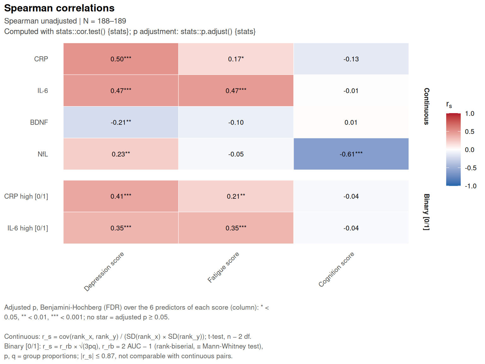
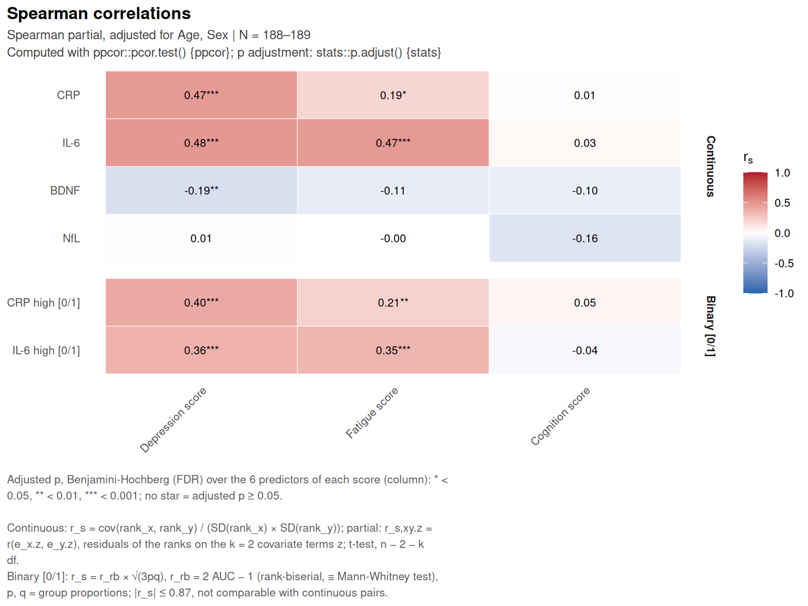
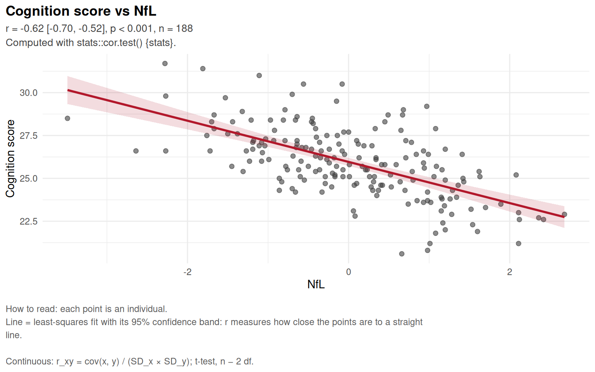
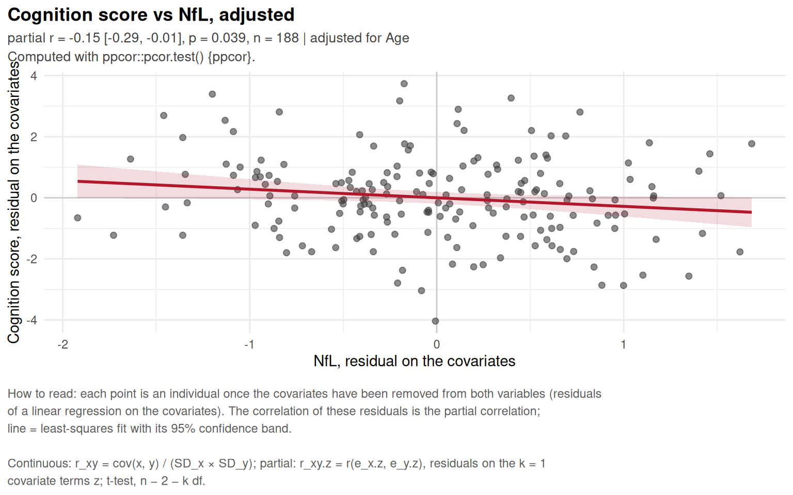
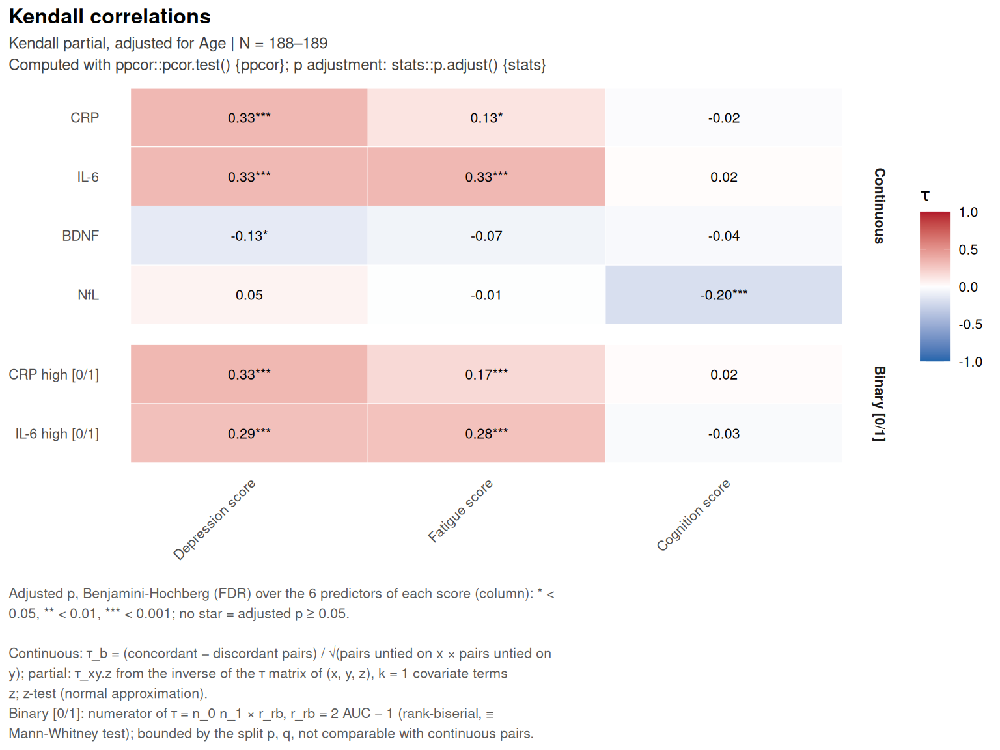

# Corrélations croisées et partielles

``` r

library(corrkit)
d   <- simulate_cor_data(n = 200)
lab <- attr(d, "labels")
biomarkers <- c("CRP", "IL6", "BDNF", "NfL", "BIN_CRP", "BIN_IL6")
scores     <- c("depression", "fatigue", "cognition")
```

## Corrélations croisées : des prédicteurs × des scores

Quand la question est « quels biomarqueurs sont liés à quels scores ? »,
la matrice complète mélange des paires sans intérêt (biomarqueur ×
biomarqueur).
[`cor_cross()`](https://clement-poupelin.github.io/corrkit/reference/cor_cross.md)
ne teste que les croisements :

``` r

cc0 <- cor_cross(d, biomarkers, scores, labels = lab)
cc0
#> <cor_cross> 6 x 3 Spearman correlations (unadjusted)
#>   Adjusted p, Benjamini-Hochberg (FDR) over the 6 predictors of each score (column): * < 0.05, ** < 0.01, *** < 0.001; no star = adjusted p ≥ 0.05.
#>        X depression fatigue cognition
#>      CRP    0.50***   0.17*     -0.13
#>      IL6    0.47*** 0.47***     -0.01
#>     BDNF    -0.21**   -0.10      0.01
#>      NfL     0.23**   -0.05  -0.61***
#>  BIN_CRP    0.41***  0.21**     -0.04
#>  BIN_IL6    0.35*** 0.35***     -0.04
```

``` r

plot_cor_cross(cc0)$plot
```



Les biomarqueurs binaires forment un bloc séparé (facette « Binary
\[0/1\] »), pour la raison détaillée dans
[`vignette("binary-variables")`](https://clement-poupelin.github.io/corrkit/articles/binary-variables.md).

### Quelle famille pour l’ajustement ?

L’argument `adjust_by` fixe l’ensemble de tests sur lequel
[`stats::p.adjust()`](https://rdrr.io/r/stats/p.adjust.html) est
appliqué. C’est un choix scientifique, et la légende le nomme :

| `adjust_by` | Famille | Quand l’utiliser |
|----|----|----|
| `"y"` (défaut) | les prédicteurs de chaque score (une colonne) | chaque score est une question à part : « quels biomarqueurs expliquent la dépression ? » ; c’est la famille des forest plots univariés |
| `"x"` | les scores de chaque prédicteur (une ligne) | chaque biomarqueur est une question à part : « à quoi CRP est-il lié ? » |
| `"all"` | tous les tests du tableau | une seule question globale, ou un criblage |
| `"none"` | aucun ajustement | analyses préspécifiées ou purement descriptives |

``` r

sapply(c("y", "x", "all", "none"),
       function(a) sum(cor_cross(d, biomarkers, scores, adjust_by = a)$table$p_adj < 0.05))
#>    y    x  all none 
#>   11   11   11   11
```

## Corrélations partielles

### Ce qu’est une corrélation partielle

Dans les données simulées, l’âge fait monter NfL et baisser la
cognition. Une partie de la corrélation brute NfL–cognition passe donc
par l’âge. La corrélation **partielle** retire l’effet des covariables z
de chacune des deux variables, puis corrèle ce qui reste. Avec la
notation de Makowski et al. (2020) : si $`e_{x.z}`$ sont les résidus de
la régression linéaire de x sur z,

``` math
r_{xy.z} = r(e_{x.z},\, e_{y.z}).
```

Pour Spearman, x, y **et** z sont d’abord remplacés par leurs rangs
(comme dans `ppcor`). Le test est un t à n − 2 − k degrés de liberté, k
étant le nombre de colonnes de covariables (un facteur à m niveaux
compte pour m − 1).

``` r

cc_adj <- cor_cross(d, biomarkers, scores, covariates = c("age", "sex"), labels = lab)
```

``` r

res <- plot_cor_cross(cc_adj)
res$plot
```



Le sous-titre passe de « unadjusted » à « partial, adjusted for Age, Sex
», et la formule de la légende devient celle de la corrélation
partielle, avec le nombre k de termes de covariables.

### Voir une corrélation partielle

[`plot_cor_pair()`](https://clement-poupelin.github.io/corrkit/reference/plot_cor_pair.md)
montre ce que mesure le coefficient. Sans covariable, c’est un nuage de
points ; avec covariables, c’est le graphique des résidus
(*added-variable plot*), dont la corrélation **est** la corrélation
partielle :

``` r

plot_cor_pair(d, "NfL", "cognition", labels = lab, meth = "pearson")
```



``` r

plot_cor_pair(d, "NfL", "cognition", covariates = "age", labels = lab, meth = "pearson")
```



### Trois calculs, un même résultat

Pour Pearson, la corrélation partielle et la pente de x dans
`lm(y ~ x + z)` ont **le même test** (théorème de Frisch-Waugh-Lovell :
même t, mêmes degrés de liberté). On peut le vérifier avec les deux
moteurs de
[`partial_cor_test()`](https://clement-poupelin.github.io/corrkit/reference/partial_cor_test.md)
:

``` r

Z <- d[, c("age", "sex")]
base <- partial_cor_test(d$NfL, d$cognition, Z, meth = "pearson", engine = "base")
fit  <- lm(cognition ~ NfL + age + sex, data = d)
c(residuals = base$p.value, lm_slope = summary(fit)$coefficients["NfL", "Pr(>|t|)"])
#>  residuals   lm_slope 
#> 0.04001382 0.04001382
```

``` r

pp <- partial_cor_test(d$NfL, d$cognition, Z, meth = "pearson", engine = "ppcor")
c(ppcor = pp$estimate, residuals = base$estimate)
#>      ppcor  residuals 
#> -0.1507324 -0.1507324
```

`engine = "ppcor"` (défaut) appelle
[`ppcor::pcor.test()`](https://rdrr.io/pkg/ppcor/man/pcor.test.html) ;
si le package n’est pas installé, ou si l’on demande `engine = "base"`,
le calcul se fait par les résidus. La légende indique toujours quelle
fonction a servi.

### Et `correlation::correlation(partial = TRUE)` ?

Le package **correlation** propose aussi des corrélations partielles,
mais avec une autre définition de z : chaque paire est ajustée sur
**toutes les autres variables** du jeu de données, pas sur des
covariables choisies. Makowski et al. (2020) précisent que la
partialisation y est une étape séparée qui crée un nouveau jeu de
données, si bien que les t et les p peuvent différer d’autres
implémentations comme `ppcor`, même si le coefficient est le même. Pour
des covariables choisies (âge, sexe…), `corrkit` utilise donc
[`ppcor::pcor.test()`](https://rdrr.io/pkg/ppcor/man/pcor.test.html).

``` r

sub <- na.omit(d[, c("NfL", "cognition", "age")])
cr  <- as.data.frame(correlation::correlation(sub, partial = TRUE, p_adjust = "none"))
cr[cr$Parameter1 == "NfL" & cr$Parameter2 == "cognition", c("r", "p")]
#>            r          p
#> 1 -0.1509717 0.03863221
unlist(partial_cor_test(sub$NfL, sub$cognition, sub["age"], meth = "pearson")[c("estimate", "p.value")])
#>    estimate     p.value 
#> -0.15097173  0.03916004
```

## Les tableaux

Le tableau large reprend la heatmap (même échelle de couleurs, mêmes
étoiles) ; les notes répètent la famille de l’ajustement, la formule et
la lecture des variables binaires :

``` r

tbl_cor_cross(cc_adj)
```

| Spearman correlations |  |  |  |
|----|----|----|----|
| Spearman partial, adjusted for Age, Sex \| N = 188–189 \| Computed with ppcor::pcor.test() {ppcor}; p adjustment: stats::p.adjust() {stats} |  |  |  |
| Predictor | Depression score | Fatigue score | Cognition score |
| Continuous |  |  |  |
| CRP | 0.47\*\*\* | 0.19\* | 0.01 |
| IL-6 | 0.48\*\*\* | 0.47\*\*\* | 0.03 |
| BDNF | -0.19\*\* | -0.11 | -0.10 |
| NfL | 0.01 | -0.00 | -0.16 |
| Binary \[0/1\] |  |  |  |
| CRP high \[0/1\]¹ | 0.40\*\*\* | 0.21\*\* | 0.05 |
| IL-6 high \[0/1\]¹ | 0.36\*\*\* | 0.35\*\*\* | -0.04 |
| ¹ \[0/1\] binary: r_s ≈ Mann-Whitney (rank difference between groups); \|r_s\| ≤ √(3pq) ≤ 0.87, not comparable with continuous variables |  |  |  |
| Cells: r_s and stars; colour = same scale as the heatmap (blue \< 0 \< red). Confidence intervals: tbl_cor_long(). |  |  |  |
| Adjusted p, Benjamini-Hochberg (FDR) over the 6 predictors of each score (column): \* \< 0.05, \*\* \< 0.01, \*\*\* \< 0.001; no star = adjusted p ≥ 0.05. |  |  |  |
| Continuous: r_s = cov(rank_x, rank_y) / (SD(rank_x) × SD(rank_y)); partial: r_s,xy.z = r(e_x.z, e_y.z), residuals of the ranks on the k = 2 covariate terms z; t-test, n − 2 − k df. |  |  |  |
| Binary \[0/1\]: r_s = r_rb × √(3pq), r_rb = 2 AUC − 1 (rank-biserial, ≡ Mann-Whitney test), p, q = group proportions; \|r_s\| ≤ 0.87, not comparable with continuous pairs. |  |  |  |
| Notation: Makowski D, Ben-Shachar MS, Patil I, Lüdecke D (2020), J Open Source Softw 5(51):2306, doi:10.21105/joss.02306. |  |  |  |

Le tableau long donne, pour chaque paire, n, le coefficient, son
intervalle de confiance (z de Fisher sur n − k), la p brute et la p
ajustée. Les lignes sont regroupées par famille d’ajustement, ce qui
permet de relire l’ajustement à la main :

``` r

tbl_cor_long(cc_adj, sort_by = "abs")
```

| Spearman correlations |  |  |  |  |  |  |
|----|----|----|----|----|----|----|
| Spearman partial, adjusted for Age, Sex \| N = 188–189 \| Computed with ppcor::pcor.test() {ppcor}; p adjustment: stats::p.adjust() {stats} |  |  |  |  |  |  |
| Predictor | Pair | n | rₛ | 95% CI | p (raw) | p (adjusted) |
| Depression score |  |  |  |  |  |  |
| IL-6 | cont × cont | 188 | 0.48 | \[0.36, 0.59\] | \< 0.001 | \< 0.001 \*\*\* |
| CRP | cont × cont | 188 | 0.47 | \[0.35, 0.58\] | \< 0.001 | \< 0.001 \*\*\* |
| CRP high \[0/1\] | bin × cont | 188 | 0.40 | \[0.27, 0.52\] | \< 0.001 | \< 0.001 \*\*\* |
| IL-6 high \[0/1\] | bin × cont | 188 | 0.36 | \[0.23, 0.48\] | \< 0.001 | \< 0.001 \*\*\* |
| BDNF | cont × cont | 188 | -0.19 | \[-0.33, -0.05\] | 0.008 | 0.010 \*\* |
| NfL | cont × cont | 188 | 0.01 | \[-0.13, 0.16\] | 0.853 | 0.853 |
| Fatigue score |  |  |  |  |  |  |
| IL-6 | cont × cont | 189 | 0.47 | \[0.35, 0.58\] | \< 0.001 | \< 0.001 \*\*\* |
| IL-6 high \[0/1\] | bin × cont | 189 | 0.35 | \[0.21, 0.47\] | \< 0.001 | \< 0.001 \*\*\* |
| CRP high \[0/1\] | bin × cont | 188 | 0.21 | \[0.07, 0.35\] | 0.004 | 0.008 \*\* |
| CRP | cont × cont | 188 | 0.19 | \[0.04, 0.33\] | 0.010 | 0.015 \* |
| BDNF | cont × cont | 189 | -0.11 | \[-0.26, 0.03\] | 0.118 | 0.141 |
| NfL | cont × cont | 189 | -0.00 | \[-0.15, 0.15\] | 0.997 | 0.997 |
| Cognition score |  |  |  |  |  |  |
| NfL | cont × cont | 188 | -0.16 | \[-0.30, -0.02\] | 0.026 | 0.156 |
| BDNF | cont × cont | 188 | -0.10 | \[-0.25, 0.05\] | 0.162 | 0.486 |
| CRP high \[0/1\] | bin × cont | 188 | 0.05 | \[-0.10, 0.19\] | 0.534 | 0.779 |
| IL-6 high \[0/1\] | bin × cont | 188 | -0.04 | \[-0.19, 0.11\] | 0.555 | 0.779 |
| IL-6 | cont × cont | 188 | 0.03 | \[-0.12, 0.18\] | 0.649 | 0.779 |
| CRP | cont × cont | 188 | 0.01 | \[-0.14, 0.16\] | 0.861 | 0.861 |
| Row groups = family of the p adjustment (the 6 predictors of each score (column)). |  |  |  |  |  |  |
| Pair: cont = continuous, bin = binary\[0/1\]. Bold = adjusted p \< 0.05. |  |  |  |  |  |  |
| Adjusted p, Benjamini-Hochberg (FDR) over the 6 predictors of each score (column): \* \< 0.05, \*\* \< 0.01, \*\*\* \< 0.001; no star = adjusted p ≥ 0.05. |  |  |  |  |  |  |
| Continuous: r_s = cov(rank_x, rank_y) / (SD(rank_x) × SD(rank_y)); partial: r_s,xy.z = r(e_x.z, e_y.z), residuals of the ranks on the k = 2 covariate terms z; t-test, n − 2 − k df. |  |  |  |  |  |  |
| 95% CI: Fisher z transformation, SE = √(1.06 / (n − 3 − k)) (Fieller et al. 1957); computed with correlation::cor_to_ci() {correlation}. |  |  |  |  |  |  |
| Binary \[0/1\]: r_s = r_rb × √(3pq), r_rb = 2 AUC − 1 (rank-biserial, ≡ Mann-Whitney test), p, q = group proportions; \|r_s\| ≤ 0.87, not comparable with continuous pairs. |  |  |  |  |  |  |
| Notation: Makowski D, Ben-Shachar MS, Patil I, Lüdecke D (2020), J Open Source Softw 5(51):2306, doi:10.21105/joss.02306. |  |  |  |  |  |  |

[`tbl_cor_cross()`](https://clement-poupelin.github.io/corrkit/reference/tbl_cor_cross.md)
et
[`tbl_cor_long()`](https://clement-poupelin.github.io/corrkit/reference/tbl_cor_long.md)
acceptent aussi directement la liste renvoyée par
[`plot_cor_cross()`](https://clement-poupelin.github.io/corrkit/reference/plot_cor_cross.md)
:

``` r

res <- plot_cor_cross(d, biomarkers, scores, covariates = c("age", "sex"), labels = lab)
res$plot
tbl_cor_cross(res)
cat(res$note)        # note complète sur les variables binaires
```

## Kendall

`meth = "kendall"` fonctionne partout ; les versions partielles
demandent `ppcor`. Le test est alors un z (approximation normale) et la
légende l’indique.

``` r

plot_cor_cross(d, biomarkers, scores, covariates = "age", labels = lab, meth = "kendall")$plot
```



## Références

- Makowski D, Ben-Shachar MS, Patil I, Lüdecke D (2020). Methods and
  algorithms for correlation analysis in R. *Journal of Open Source
  Software* 5(51):2306. doi:10.21105/joss.02306
- Kim S (2015). ppcor: an R package for a fast calculation to
  semi-partial correlation coefficients. *Communications for Statistical
  Applications and Methods* 22(6):665-674.
  doi:10.5351/CSAM.2015.22.6.665
- Fieller EC, Hartley HO, Pearson ES (1957). Tests for rank correlation
  coefficients. I. *Biometrika* 44(3/4):470-481.
